# Arquitetura do Billing Service

O Billing Service é um dos três serviços do PytStop na fase 4 do Tech Challenge (FIAP Pós Tech, Software Architecture): o sistema de gestão de oficina das fases anteriores, refatorado em microsserviços com saga orquestrada e mensageria assíncrona. A *saga* é a sequência de passos locais, um em cada serviço, coordenada pelo OS Service: se um passo falha, os já feitos são desfeitos por comandos de compensação.

- **Arquitetura global.** A divisão dos serviços, o catálogo de mensagens, a borda, a observabilidade e a implantação estão na [RFC-004](https://github.com/fiap-postech-sw-architecture/postech-sw-arch-p4-platform/blob/main/docs/arquitetura/rfc/fase4/rfc-004-microsservicos-saga.md) e nos [ADR-034 a ADR-043](https://github.com/fiap-postech-sw-architecture/postech-sw-arch-p4-platform/tree/main/docs/arquitetura) do `platform`.
- **Este documento.** O que é deste serviço: responsabilidades, camadas e módulos, o modelo completo do banco (a [seção 7.4 da RFC-004](https://github.com/fiap-postech-sw-architecture/postech-sw-arch-p4-platform/blob/main/docs/arquitetura/rfc/fase4/rfc-004-microsservicos-saga.md#74-billing-service-mongodb-7) o delega para cá), os fluxos passo a passo, os comandos consumidos e os eventos publicados. É a documentação da arquitetura do serviço que a [gap analysis](https://github.com/fiap-postech-sw-architecture/postech-sw-arch-p4-platform/blob/main/docs/requisitos/fase4/gap-analysis-fase-4.md) da fase pede no RNF-051 (a arquitetura de cada serviço, com os comandos e eventos que ele consome e publica).
- **API e operação.** O [README](../README.md) resume a operação e aponta os documentos de `docs/` (configuração, implantação, testes, mutação); há um `curl` por rota em [Exemplos da API](api/exemplos.md), e a evidência de cobertura (RNF-050) está em [Cobertura](../README.md#cobertura). O OpenAPI exportado e a coleção Postman com exemplos (RNF-052) estão em [`docs/api/`](api/); a coleção do fluxo completo, que roda com newman, é do `platform`.

Conferido em 18/10/2026 contra o código de `src/` da `main` do Billing (commit `d6d2776`), contra a `ETAPA_ESPERADA` da `main` do OS Service (commit `e2bf48d`, só a coluna "Etapa esperada" da seção 5) e contra a RFC-004 da `main` do `platform` (commit `c4066ac`). Os testes de `tests/unitarios/test_documentacao.py` seguram o que o código decide: os nomes dos campos e a coluna "Validador" das coleções (o tipo e as marcas PK e UK do ER ficam de fora), os índices, os estados dos agregados e, nas tabelas da seção 5, quais mensagens existem, a routing key (a chave pela qual o exchange escolhe a fila), quem publica, quem consome e a fila. Ficam sem teste as colunas "Resposta" (só se confere que o evento citado existe), "Etapa esperada" e "Quando sai".

Sumário:

1. [Contexto e responsabilidades](#1-contexto-e-responsabilidades)
2. [Camadas e módulos](#2-camadas-e-módulos)
3. [Modelo de dados](#3-modelo-de-dados)
4. [Fluxos passo a passo](#4-fluxos-passo-a-passo)
5. [Mensageria](#5-mensageria)
6. [Segurança e LGPD](#6-segurança-e-lgpd)
7. [Observabilidade](#7-observabilidade)
8. [Decisões](#8-decisões)

## 1. Contexto e responsabilidades

O Billing Service cuida do dinheiro da oficina. Ele é dono de:

- **Tabela de preços.** Os preços comerciais de serviços (por código) e de peças (por SKU, o código que a Execução usa no estoque). Só o admin escreve.
- **Orçamento.** Um por ordem de serviço. Nasce do comando `GerarOrcamento` com os preços congelados nas linhas, espera a decisão do cliente (pelo link público ou pelo atendente) e expira se ninguém decide. É o passo T3 da saga, e a decisão é o T4 ([RFC-004, seção 4.3](https://github.com/fiap-postech-sw-architecture/postech-sw-arch-p4-platform/blob/main/docs/arquitetura/rfc/fase4/rfc-004-microsservicos-saga.md#43-passos-compensações-e-tipos)).
- **Pagamento.** Uma cobrança por ordem, aberta no Checkout Pro do Mercado Pago (a página de pagamento que o próprio provedor hospeda). O status só muda pelo que o provedor confirma numa consulta, nunca pelo corpo do webhook, e a compensação da saga o cancela ou o estorna. É o passo T6.
- **Mensageria do serviço.** A outbox (as mensagens a publicar, gravadas na mesma transação do efeito), o relay que as publica e o consumidor dos comandos.

Não são dele a ordem de serviço, o cadastro de clientes e a orquestração da saga (OS Service), nem o diagnóstico, o estoque e a execução (Execução). O Billing não guarda nome, documento nem contato de cliente: sabe só o `ordem_id`, as linhas do orçamento e o que o provedor de pagamento informou. A única chamada síncrona que ele recebe de outro serviço é a validação de códigos feita pela Execução (`POST /api/v1/precos/validacao`). O único acesso dele ao OS Service é a leitura das chaves públicas (o JWKS, *JSON Web Key Set*, que o OS publica) para validar o JWT, e tudo o mais passa pelo RabbitMQ.

| É dono de | Não é dono de |
|---|---|
| Preços de serviços e de peças | Ordem de serviço, clientes, veículos e usuários (OS Service) |
| Orçamentos e a decisão do cliente | Estado da saga e plano de compensação (OS Service) |
| Pagamentos e a conversa com o Mercado Pago | Diagnóstico, estoque, reserva e execução (Execução) |
| O link público de decisão e o checkout simulado | O envio do e-mail com os links (OS Service) |

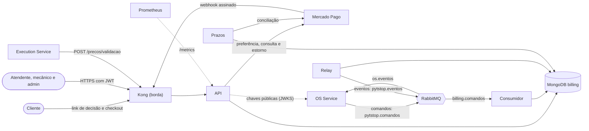

### Processos

Todos saem da mesma imagem e do mesmo código; muda o comando (`entrypoint.sh`).

| Processo | Comando | O que faz | Fala com |
|---|---|---|---|
| API | `uvicorn src.main:criar_app --factory` | Rotas HTTP, Swagger em `/docs`, `/metrics` e as sondas. Grava preço, orçamento, pagamento e os eventos da outbox na mesma transação | MongoDB, JWKS do OS Service, Mercado Pago |
| consumidor | `python -m src.consumidor` | Consome `billing.comandos`, uma mensagem por vez, e executa o caso de uso do comando na transação da própria mensagem | MongoDB, RabbitMQ, Mercado Pago |
| relay | `python -m src.relay` | Publica as linhas pendentes da outbox no exchange `pytstop.eventos` (o ponto do RabbitMQ que roteia cada mensagem às filas), com confirmação do broker | MongoDB, RabbitMQ |
| prazos | `python -m src.prazos` | A cada ciclo, concilia os pagamentos solicitados com o Mercado Pago (só com o provedor real) e expira orçamentos e pagamentos vencidos | MongoDB, Mercado Pago |
| banco | `python -m src.banco` | Cria as coleções com validador, os índices e marca a versão do banco; idempotente (rodar de novo não muda o resultado). É o Job de inicialização no Kubernetes e o serviço `init` do compose | MongoDB |
| aguarda-banco | `python -m src.banco aguardar` | initContainer dos Deployments: espera a versão do banco que o código conhece | MongoDB |

O `python -m src.seed` cadastra os preços de demonstração que faltam. As portas, as sondas, o arquivo de vida de cada processo e os manifests estão em [Implantação](implantacao.md).

## 2. Camadas e módulos

DDD com arquitetura em camadas (onion): `dominio` ← `aplicacao` ← `infraestrutura` e `interfaces`. O `import-linter` prende os contratos no `make check` ([`pyproject.toml`](../pyproject.toml), `[tool.importlinter]`):

- a camada de cima importa as de baixo e nunca o contrário, em cada contexto e em `compartilhado`;
- domínio e aplicação não importam a infraestrutura, nem os frameworks e drivers da lista do contrato (FastAPI, Pydantic, PyMongo, httpx, PyJWT, pika, OpenTelemetry e outros);
- `compartilhado` não conhece contexto algum;
- o núcleo (domínio e aplicação) de um contexto não importa o de outro, e nenhum contexto importa a camada `interfaces` de outro.

| Módulo | O que tem |
|---|---|
| `src/compartilhado` | Base de entidades, agregados e objetos de valor (`Entity`, `AggregateRoot`, `ValueObject`, `Dinheiro`), exceções de domínio, relógio, eventos; porta e envelope da outbox, token assinado (HMAC, código de autenticação de mensagem com hash); cliente e unidade de trabalho do MongoDB, JWKS, circuit breaker, logging com mascaramento, métricas, telemetria e a mensageria (AMQP, consumidor, relay, contratos); autenticação, envelope de erro, middleware de segurança e as sondas |
| `src/precos` | `PrecoServico` (código) e `PrecoPeca` (SKU); casos de uso do CRUD e da validação de itens; rotas `/api/v1/precos` |
| `src/orcamento` | `Orcamento` e as linhas com preço congelado; `GerarOrcamento`, `CancelarOrcamento`, a decisão, a consulta e a expiração; link de decisão; rotas do atendente e rota pública |
| `src/pagamento` | `Pagamento`, a cobrança e o histórico do provedor; `SolicitarPagamento`, `EstornarPagamento`, o processamento da notificação, a conciliação e a expiração; adapters do Mercado Pago e do simulador; webhook e rotas do simulador |
| `src/main.py`, `src/consumidor.py`, `src/relay.py`, `src/prazos.py`, `src/banco.py`, `src/seed.py` | Os processos; `criar_handlers` liga cada comando ao caso de uso do contexto dono |
| `src/configuracao.py` | Uma classe de configuração por processo, lida do ambiente no boot; o que falta ou é inseguro recusa o boot |

Cada contexto segue o mesmo corte: `dominio` (agregados, objetos de valor, regras e a porta do repositório), `aplicacao` (casos de uso, DTOs e portas para fora do contexto), `infraestrutura` (repositório MongoDB e adapters) e `interfaces` (rotas, schemas Pydantic e os handlers dos comandos). A conversa entre contextos passa por portas na aplicação e adapters na infraestrutura:

| Quem pergunta | Porta | Quem responde |
|---|---|---|
| Orçamento | `TabelaDePrecosPort`: o preço vigente de cada código, na mesma transação do orçamento; inativo conta como inválido | `TabelaDePrecosMongoAdapter` (lê os repositórios de preços) |
| Pagamento | `OrcamentosPort`: o orçamento existe, é da ordem, está aprovado e quais são as linhas | `OrcamentosMongoAdapter` (lê o repositório do orçamento) |
| Pagamento | `GatewayPagamento`: criar a cobrança, cancelá-la, consultar, buscar por referência externa e estornar | `MercadoPagoGateway` ou `GatewayPagamentoSimulado`, escolhidos por `MP_MODE` em `gateway.py` |

## 3. Modelo de dados

MongoDB 7 em replica set (o grupo de nós com réplica que o MongoDB exige para transações multidocumento), banco `billing`, só deste serviço ([ADR-037](https://github.com/fiap-postech-sw-architecture/postech-sw-arch-p4-platform/blob/main/docs/arquitetura/adr/fase4/037-banco-por-servico.md)).

- **Quem cria.** O `python -m src.banco` cria as coleções, os validadores e os índices a partir do que cada repositório declara: [`precos`](../src/precos/infraestrutura/repository.py), [`orcamentos`](../src/orcamento/infraestrutura/repository.py), [`pagamentos`](../src/pagamento/infraestrutura/repository.py), [`outbox` e `mensagens_processadas`](../src/compartilhado/infraestrutura/unit_of_work.py) e [`versao_do_banco`](../src/compartilhado/infraestrutura/mongo.py). Os outros processos só conferem a versão.
- **Validador.** O `$jsonSchema` é de nível `moderate`: vale para inserção e para atualização de documento válido. A leitura tolera campo novo (expandir e contrair).

- **Dinheiro** é `Decimal128` com a `moeda`, num subdocumento `{valor, moeda}`; nunca `double`. Nas mensagens e nas respostas da API vai como texto decimal (`"570.00"`).
- **Identificadores** são UUID nativo (binário subtipo 4). O `_id` do orçamento e do pagamento é o id do recurso; o da mensagem da outbox é um UUIDv7, ordenado pelo tempo.
- **Datas** são `date` do BSON, em UTC e em milissegundos; `valido_ate` é em segundo cheio, porque o token do link assina a expiração em segundos.
- **Lápide** é o registro que a compensação grava quando chega antes do comando original (o passo em voo): já cancelado, sem cobrança nem linhas. O comando original, quando chegar, acha a lápide pelo índice único de `ordem_id` e é descartado.
- **Relações** entre coleções são lógicas, sem chave estrangeira (o MongoDB não tem): `orcamentos.ordem_id` e `pagamentos.ordem_id` são a ordem de serviço do OS Service, e `pagamentos.orcamento_id` aponta o orçamento aprovado que gerou a cobrança.

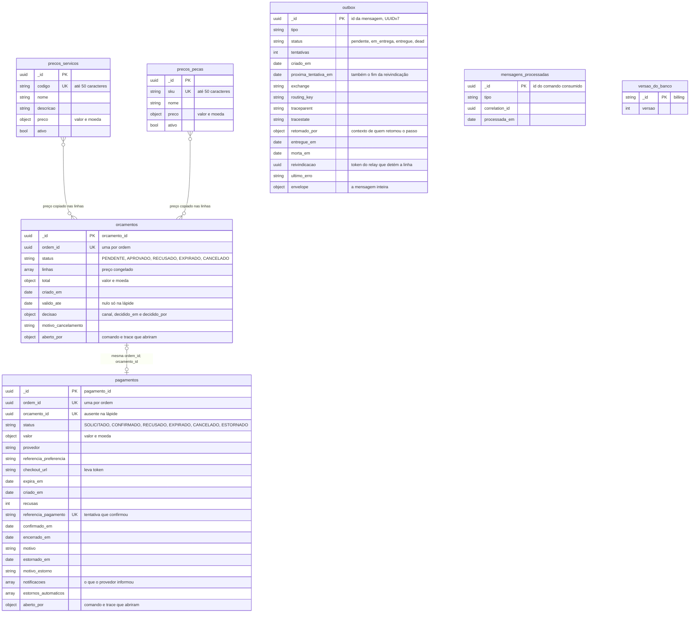

### 3.1 Preços

Cada serviço tem um `codigo` e cada peça, um `sku`: letras maiúsculas e dígitos separados por hífens (`PEC-OLEO-5W30`), até 50 caracteres. O preço é maior que zero e, pela API, tem até 8 dígitos antes da vírgula e 2 depois. `ativo` é a situação: `DELETE` e `PUT` com `ativo: false` desativam, e o `PUT` com `ativo: true` reativa. Desativar não apaga o documento e não muda os orçamentos já gerados, que têm o preço copiado.

Na tabela de cada coleção, a coluna "Validador" diz se o campo de primeiro nível é `obrigatório` ou `opcional` no `$jsonSchema`, ou `não declarado` quando o validador não o descreve. Nos campos aninhados, `obrigatório no objeto` é o que o validador de dinheiro exige (`valor` e `moeda`), e o resto é `não declarado`.

#### `precos_servicos`

| Campo | Tipo | Validador | Regra |
|---|---|---|---|
| `_id` | UUID | não declarado | id do agregado |
| `codigo` | texto | obrigatório | `UNIQUE`; de 1 a 50 caracteres |
| `nome` | texto | obrigatório | não vazio; é a `descricao` da linha do orçamento |
| `descricao` | texto | obrigatório | não vazio; não vai para o orçamento |
| `preco` | objeto | obrigatório | `valor` e `moeda` |
| `preco.valor` | `Decimal128` | obrigatório no objeto | maior que zero |
| `preco.moeda` | texto | obrigatório no objeto | 3 letras (`BRL`) |
| `ativo` | booleano | obrigatório | situação do preço |

#### `precos_pecas`

| Campo | Tipo | Validador | Regra |
|---|---|---|---|
| `_id` | UUID | não declarado | id do agregado |
| `sku` | texto | obrigatório | `UNIQUE`; de 1 a 50 caracteres; o mesmo SKU do estoque da Execução |
| `nome` | texto | obrigatório | não vazio; é a `descricao` da linha do orçamento |
| `preco` | objeto | obrigatório | `valor` e `moeda` |
| `preco.valor` | `Decimal128` | obrigatório no objeto | maior que zero |
| `preco.moeda` | texto | obrigatório no objeto | 3 letras (`BRL`) |
| `ativo` | booleano | obrigatório | situação do preço |

### 3.2 Orçamento

Um documento por orçamento, com as linhas embutidas. O subtotal de cada linha não é gravado: é a quantidade vezes o preço unitário, e o `total` é a soma das linhas. A **lápide** é o orçamento que um `CancelarOrcamento` grava quando chega antes do `GerarOrcamento` (o passo ainda em voo): já `CANCELADO`, sem linhas e sem validade. O `GerarOrcamento` que chegar depois acha a lápide pelo índice único de `ordem_id` e é descartado.

#### `orcamentos`

| Campo | Tipo | Validador | Regra |
|---|---|---|---|
| `_id` | UUID | não declarado | `orcamento_id`; o link de decisão assina este id |
| `ordem_id` | UUID | obrigatório | `UNIQUE`: um orçamento (ou lápide) por ordem |
| `status` | texto | obrigatório | um dos cinco estados da seção 3.6 |
| `linhas` | lista | obrigatório | vazia só na lápide |
| `linhas[].tipo` | texto | não declarado | `servico` ou `peca` |
| `linhas[].codigo` | texto | não declarado | código do serviço ou SKU da peça, até 50 caracteres |
| `linhas[].descricao` | texto | não declarado | o `nome` da tabela de preços na geração, até 255 caracteres |
| `linhas[].quantidade` | inteiro | não declarado | de 1 a 1000 |
| `linhas[].preco_unitario` | objeto | não declarado | `valor` e `moeda`, congelados na geração |
| `linhas[].preco_unitario.valor` | `Decimal128` | não declarado | |
| `linhas[].preco_unitario.moeda` | texto | não declarado | a mesma moeda em todas as linhas |
| `total` | objeto | opcional | soma das linhas, gravada para consulta; a fonte é a soma |
| `total.valor` | `Decimal128` | obrigatório no objeto | |
| `total.moeda` | texto | obrigatório no objeto | |
| `criado_em` | data | obrigatório | com fuso (UTC) |
| `valido_ate` | data | opcional | prazo da decisão, em segundo cheio e depois de `criado_em`; nulo só na lápide |
| `decisao` | objeto | não declarado | nulo enquanto `PENDENTE` ou `EXPIRADO`; obrigatório em `APROVADO` e `RECUSADO`; o `CANCELADO` guarda a que havia |
| `decisao.canal` | texto | não declarado | `link` ou `atendente` |
| `decisao.decidido_em` | data | não declarado | |
| `decisao.decidido_por` | texto | não declarado | o `sub` do atendente (UUID), só com `canal: atendente`; nulo no link |
| `motivo_cancelamento` | texto | não declarado | código que o OS manda no `CancelarOrcamento`; só (e sempre) no `CANCELADO` |
| `aberto_por` | objeto | opcional | gravado uma vez, na criação durante um comando |
| `aberto_por.mensagem_id` | UUID | não declarado | `id` do `GerarOrcamento`: o `causation_id` dos eventos que o orçamento emite sem comando |
| `aberto_por.traceparent` | texto | não declarado | contexto de trace do comando (W3C) |
| `aberto_por.tracestate` | texto | não declarado | idem |

### 3.3 Pagamento

Um documento por pagamento. A cobrança (`orcamento_id`, `valor`, `provedor`, `referencia_preferencia`, `checkout_url` e `expira_em`) só falta na lápide: a compensação que chega antes do `SolicitarPagamento` grava o pagamento já `CANCELADO`, sem cobrança, e o comando atrasado é descartado. Os campos de data e de motivo seguem o status: `confirmado_em` e `referencia_pagamento` no `CONFIRMADO`, `encerrado_em` e `motivo` nos que fecham sem pagamento, `estornado_em` e `motivo_estorno` no `ESTORNADO`. O domínio confere essa coerência também ao ler o documento.

#### `pagamentos`

| Campo | Tipo | Validador | Regra |
|---|---|---|---|
| `_id` | UUID | não declarado | `pagamento_id`; é a `external_reference` da preferência no Mercado Pago |
| `ordem_id` | UUID | obrigatório | `UNIQUE`: um pagamento (ou lápide) por ordem; a compensação o acha por aqui |
| `status` | texto | obrigatório | um dos seis estados da seção 3.6 |
| `criado_em` | data | obrigatório | |
| `recusas` | inteiro | obrigatório | recusas do provedor contadas, de 0 em diante; a de número `PAGAMENTO_MAX_RECUSAS` fecha a cobrança |
| `orcamento_id` | UUID | opcional | `UNIQUE` parcial: uma cobrança por orçamento; ausente na lápide |
| `valor` | objeto | opcional | o total do orçamento; ausente na lápide |
| `valor.valor` | `Decimal128` | obrigatório no objeto | maior que zero |
| `valor.moeda` | texto | obrigatório no objeto | |
| `provedor` | texto | não declarado | `mercadopago` ou `simulado` |
| `referencia_preferencia` | texto | não declarado | id da preferência no provedor; com ele a compensação fecha o checkout |
| `checkout_url` | texto | não declarado | URL do checkout, com token; credencial (seção 6) |
| `expira_em` | data | opcional | fim do prazo da cobrança |
| `referencia_pagamento` | texto | opcional | `UNIQUE` parcial: a tentativa do provedor que confirmou o pagamento; nulo antes |
| `confirmado_em` | data | não declarado | só no `CONFIRMADO` |
| `encerrado_em` | data | não declarado | quando a cobrança fechou sem pagamento (`RECUSADO`, `EXPIRADO`, `CANCELADO`) |
| `motivo` | texto | não declarado | por que fechou, até 500 caracteres; pode trazer o texto do provedor |
| `estornado_em` | data | não declarado | só no `ESTORNADO` |
| `motivo_estorno` | texto | não declarado | `compensacao` ou `pagamento_apos_encerramento` |
| `notificacoes` | lista | opcional | cada tentativa que o provedor mostrou, uma vez por par (tentativa, status) |
| `notificacoes[].recebida_em` | data | não declarado | |
| `notificacoes[].referencia_pagamento` | texto | não declarado | id da tentativa no provedor |
| `notificacoes[].status_provedor` | texto | não declarado | o status bruto (`approved`, `rejected`...) |
| `estornos_automaticos` | lista | opcional | devoluções feitas sem pedido da saga, uma por tentativa |
| `estornos_automaticos[].referencia_pagamento` | texto | não declarado | a tentativa estornada |
| `estornos_automaticos[].registrado_em` | data | não declarado | |
| `estornos_automaticos[].falha` | texto | não declarado | preenchido quando o provedor recusou o estorno, com a mensagem fixa `Provedor de pagamento recusou a operacao`; documento antigo pode guardar o texto do provedor (até 500 caracteres), e a consulta o devolve com a mesma mensagem fixa |
| `aberto_por` | objeto | opcional | gravado uma vez, na criação durante um comando |
| `aberto_por.mensagem_id` | UUID | não declarado | `id` do `SolicitarPagamento` |
| `aberto_por.traceparent` | texto | não declarado | contexto de trace do comando (W3C) |
| `aberto_por.tracestate` | texto | não declarado | idem |

### 3.4 Mensageria

A **outbox** é a coleção das mensagens a publicar: o caso de uso grava o estado e a linha da outbox na mesma transação, e o relay as publica depois. O envelope é validado contra o JSON Schema do contrato antes de gravar. Uma linha passa por `pendente`, `em_entrega` (reivindicada por um relay por um prazo, o *lease*) e `entregue`, ou chega a `dead` na quinta falha de publicação.

#### `outbox`

| Campo | Tipo | Validador | Regra |
|---|---|---|---|
| `_id` | UUID | não declarado | `id` do envelope (UUIDv7): a ordem de publicação |
| `tipo` | texto | obrigatório | nome do evento |
| `status` | texto | obrigatório | `pendente`, `em_entrega`, `entregue` ou `dead` |
| `tentativas` | inteiro | obrigatório | falhas de publicação contadas |
| `criado_em` | data | obrigatório | |
| `proxima_tentativa_em` | data | obrigatório | quando a linha volta a ser elegível e, em entrega, o fim do lease |
| `exchange` | texto | obrigatório | `pytstop.eventos` |
| `routing_key` | texto | obrigatório | `evento.billing.<tipo em snake_case>` |
| `traceparent` | texto | opcional | contexto de trace de quem gravou: a publicação sai como filha dele |
| `tracestate` | texto | opcional | idem |
| `retomado_por` | objeto | opcional | contexto de quem retomou o passo (requisição, webhook, ciclo do `prazos`): vira *span link*, a ligação entre dois traces, na publicação |
| `entregue_em` | data | opcional | confirmação do broker; começa a retenção de 7 dias |
| `morta_em` | data | opcional | começa a retenção da linha `dead`, de 30 dias |
| `reivindicacao` | UUID | opcional | token do relay que detém a linha; toda marcação o exige (*fencing*: o relay atrasado não sobrescreve o que outro retomou) |
| `ultimo_erro` | texto | opcional | só a classe do erro ou o código do broker |
| `envelope` | objeto | obrigatório | a mensagem inteira (seção 5) |

#### `mensagens_processadas`

| Campo | Tipo | Validador | Regra |
|---|---|---|---|
| `_id` | UUID | não declarado | `id` do comando consumido; é a chave da idempotência |
| `tipo` | texto | obrigatório | nome do comando |
| `correlation_id` | UUID | obrigatório | a ordem de serviço |
| `processada_em` | data | obrigatório | grava-se uma vez; o índice TTL (*time to live*, que apaga o documento sozinho) conta daqui |

#### `versao_do_banco`

Um único documento, `{_id: "billing", versao}`. A versão sobe com `$max` quando o `python -m src.banco` termina. O relay, o consumidor, o `prazos` e o seed recusam o boot com o banco numa versão menor que a do código, e a API sobe e responde 503 na readiness (a sonda que diz ao Kubernetes se o pod pode receber tráfego) até a versão chegar. Banco à frente da imagem é aceito, e é isso que deixa o `rollout undo` passar.

| Campo | Tipo | Validador | Regra |
|---|---|---|---|
| `_id` | texto | não declarado | `billing` |
| `versao` | inteiro | não declarado | a do código (`VERSAO_DO_BANCO`) |

### 3.5 Índices

Os testes criam o banco com o mesmo código do init e comparam esta tabela com os índices que ele declara. As expressões dos filtros parciais estão ao lado, em texto.

| Coleção | Chaves | Opções | Para quê |
|---|---|---|---|
| `precos_servicos` | `codigo` | único | um preço por código; o seed e o cadastro dependem dele |
| `precos_pecas` | `sku` | único | um preço por SKU |
| `orcamentos` | `ordem_id` | único | um orçamento (ou lápide) por ordem; sustenta a idempotência do `GerarOrcamento` e a compensação por ordem |
| `orcamentos` | `status`, `valido_ate` | | a expiração: pendentes vencidos, do mais antigo ao mais novo |
| `pagamentos` | `ordem_id` | único | um pagamento (ou lápide) por ordem |
| `pagamentos` | `orcamento_id` | único, parcial | uma cobrança por orçamento; vale só onde o campo existe (`$exists`), então a lápide fica de fora |
| `pagamentos` | `referencia_pagamento` | único, parcial | uma tentativa do provedor confirma no máximo um pagamento; vale só onde o campo é texto (`$type: string`) |
| `pagamentos` | `status`, `expira_em` | | a expiração e a conciliação: solicitados, do que vence primeiro |
| `outbox` | `status`, `proxima_tentativa_em`, `_id` | | a reivindicação do relay: pendentes e leases vencidos, em ordem |
| `outbox` | `status`, `criado_em` | | a idade da linha pendente mais antiga, lida do índice sem ordenar o backlog |
| `outbox` | `entregue_em` | TTL 7 dias, parcial | apaga a linha entregue; filtro `status: entregue` |
| `outbox` | `morta_em` | TTL 30 dias, parcial | apaga a linha `dead` depois da investigação; filtro `status: dead` |
| `mensagens_processadas` | `processada_em` | TTL 30 dias | a janela de idempotência passa da retenção da DLQ (*dead letter queue*, a fila de mensagens mortas) |

O índice TTL não precisa de código de limpeza: o MongoDB apaga o documento quando passa o prazo.

### 3.6 Estados dos agregados

As transições são listas fechadas no domínio (`_TRANSICOES` em [`orcamento.py`](../src/orcamento/dominio/orcamento.py) e `TRANSICOES` em [`estados.py`](../src/pagamento/dominio/estados.py)), conferidas antes de qualquer mudança, e o validador do banco recusa um `status` que o domínio não conhece. O orçamento e o pagamento nascem em um estado e, como lápide, em `CANCELADO`.

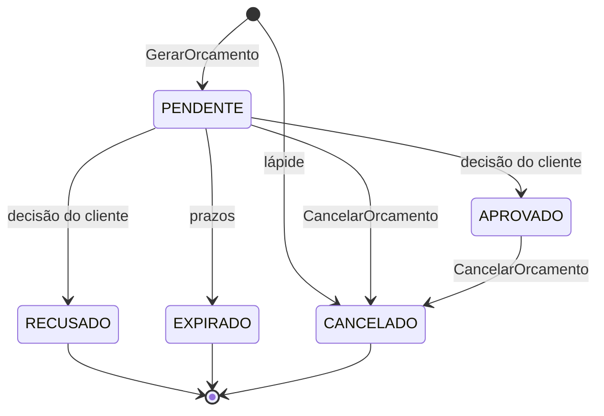

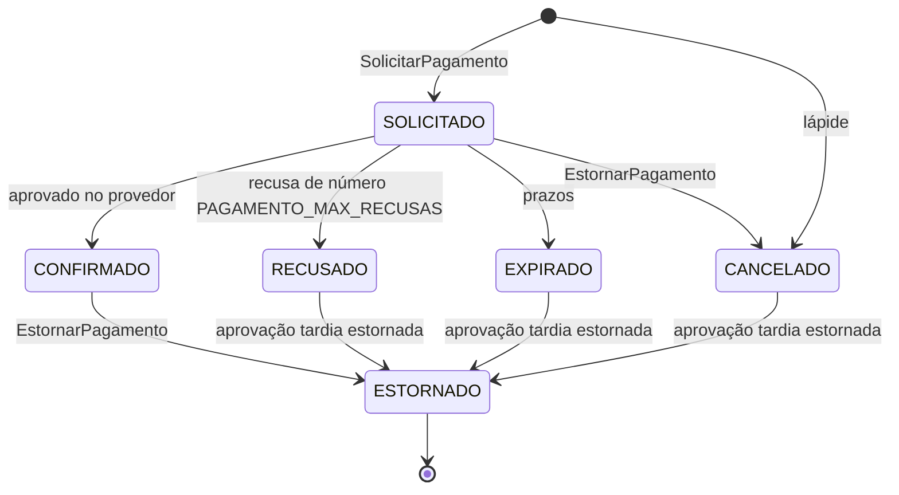

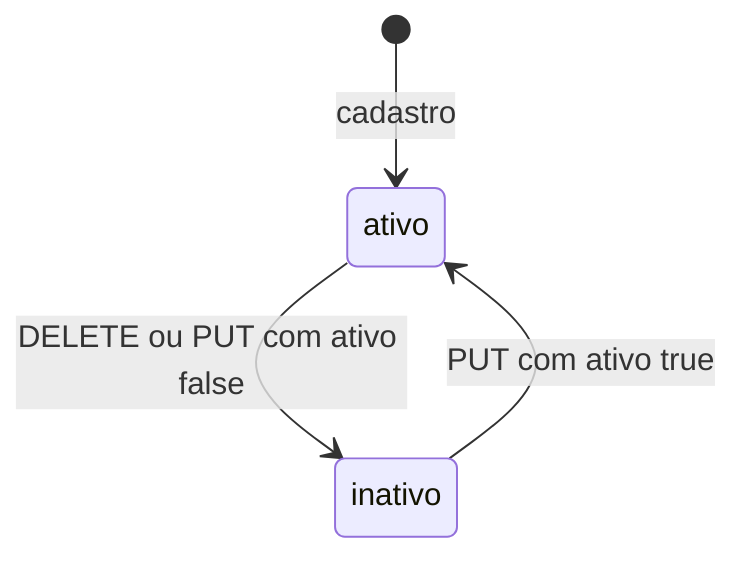

| Agregado | Estado final | O que acontece com o comando que chega depois |
|---|---|---|
| Orçamento | `RECUSADO`, `EXPIRADO`, `CANCELADO` | `CancelarOrcamento` repetido, ou sobre um orçamento recusado ou expirado, responde `OrcamentoCancelado` sem mudar nada; `GerarOrcamento` repetido republica o `OrcamentoGerado` registrado e, depois da lápide, é descartado |
| Pagamento | `ESTORNADO` | `EstornarPagamento` repetido republica o desfecho registrado, sem chamar o provedor; `SolicitarPagamento` repetido republica o `PagamentoSolicitado` e, depois da lápide, é descartado |
| Preço | nenhum | o `PUT` com `ativo: true` reativa |

### 3.7 Conferência com a RFC-004 (seção 7.4)

O modelo acima segue o da RFC, com três acréscimos que ela não descreve:

- o índice `(status, criado_em)` da `outbox`, que a versão 4 do banco trouxe para a métrica da idade da linha pendente mais antiga;
- os campos `tipo` e `correlation_id` de `mensagens_processadas`, para achar o comando consumido pelo tipo e pela ordem;
- a coleção `versao_do_banco`.

Nos exemplos da RFC, `aberto_por` mostra só o `traceparent`; o código grava também o `tracestate`, quando o contexto de trace o traz.

## 4. Fluxos passo a passo

Em todos os fluxos, o evento do catálogo é gravado na `outbox` na mesma transação do estado, e o relay o publica depois ([seção 4.7](#47-outbox-relay-e-consumidor)); os diagramas mostram a gravação, não a publicação. Os comandos chegam pelo consumidor, que comita uma vez só: o efeito, as respostas na outbox e o `id` do comando em `mensagens_processadas`, juntos ou nada. Uma chamada ao Mercado Pago fica fora da transação, porque o MongoDB repete o trabalho da transação em caso de conflito de escrita e a chamada externa não pode se repetir junto.

### 4.1 Geração do orçamento

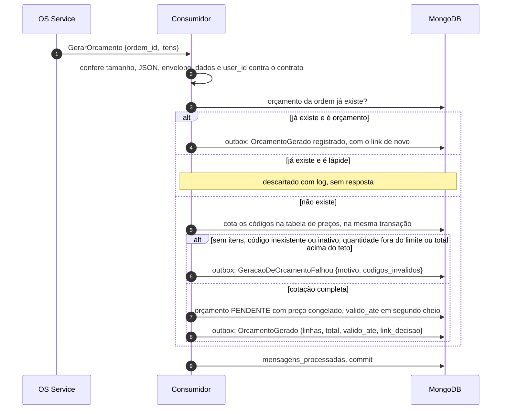

1. O consumidor valida a mensagem antes de ligá-la a log ou a span: tamanho, JSON, envelope e `dados` contra os JSON Schemas do contrato e o `user_id` contra o produtor do tipo (comandos são do usuário `os`). Falha aqui é permanente: a mensagem vai para a DLQ (*dead letter queue*, a fila de mensagens mortas, com alerta).
2. O caso de uso procura o orçamento pelo `ordem_id`. Achando um orçamento, **republica** o `OrcamentoGerado` registrado, com o link de decisão gerado de novo do mesmo `id` e do mesmo prazo: o comando repetido não cria outro orçamento. Achando a lápide, descarta o comando.
3. Sem orçamento, cota cada código (serviços e peças, sem repetição, na ordem em que vieram) na tabela de preços. Código inexistente ou inativo, diagnóstico sem itens, quantidade fora de 1 a 1000 ou total acima do teto de dinheiro responde `GeracaoDeOrcamentoFalhou`, sem gravar o orçamento; a repetição avalia de novo e responde de novo.
4. Com a cotação completa, congela o preço de cada linha, calcula o total e o prazo (`ORCAMENTO_VALIDADE_HORAS`, arredondado para o segundo cheio acima) e grava o orçamento `PENDENTE` com o `OrcamentoGerado`, que leva o `link_decisao`. O índice único de `ordem_id` decide a corrida entre duas gerações: a perdedora repete o trabalho e cai na regra de repetição.

### 4.2 Decisão do cliente

O cliente decide pelo **link público**, sem login, ou o atendente decide em nome dele. O token do link é `<orcamento_id>.<expiração em segundos>.<assinatura>`: a assinatura é um HMAC-SHA256 (código de autenticação de mensagem com hash) sobre o domínio `link-de-decisao`, o id e a expiração, com o segredo `ORCAMENTO_LINK_SECRET`. A expiração do token é o `valido_ate` do orçamento.

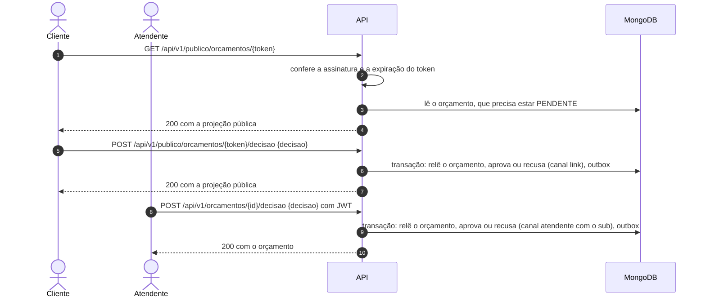

1. **Consulta pelo link.** O token adulterado, expirado ou de orçamento inexistente, e o orçamento que já não está `PENDENTE`, respondem o mesmo 404 `LINK_DECISAO_INVALIDO`: o token não vira oráculo do estado do orçamento.
2. **Decisão pelo link.** Antes do token, a API valida o corpo (`{"decisao": "aprovar"}` ou `"recusar"`, e `Content-Type: application/json`), então corpo inválido responde 422 mesmo com token inválido. Com o corpo certo, qualquer falha do token ou do estado é o mesmo 404; o orçamento vencido, que o `prazos` ainda não expirou, também.
3. **Decisão pelo atendente.** Exige o papel `atendente` (o `admin` também passa). Orçamento inexistente responde 404; já aprovado, recusado ou cancelado, 409 `TRANSICAO_STATUS_INVALIDA`; expirado, ou ainda `PENDENTE` com o prazo esgotado, 410 `ORCAMENTO_VENCIDO`. A API grava o `sub` do atendente em `decisao.decidido_por` e deixa o log de auditoria `audit_budget_decided_by_attendant`.
4. **Transação.** A decisão relê o orçamento a cada tentativa: se a expiração comitou antes, a decisão vê `EXPIRADO` e falha, e as duas nunca valem juntas. O evento (`OrcamentoAprovado` ou `OrcamentoRecusado`) vai para a outbox com o `causation_id` do `GerarOrcamento` que abriu o orçamento (o `aberto_por`) e o contexto de quem decidiu como span link.

### 4.3 Pagamento no Mercado Pago

O pagamento usa o **Checkout Pro**: o Billing cria uma preferência no Mercado Pago, e o cliente conclui na página do provedor, com PIX (QR Code), cartão ou saldo, conforme os meios habilitados na conta. O PytStop não toca em dado de cartão ([ADR-040](https://github.com/fiap-postech-sw-architecture/postech-sw-arch-p4-platform/blob/main/docs/arquitetura/adr/fase4/040-integracao-mercado-pago.md)). O Billing não gera o QR Code nem restringe os meios; o prazo da preferência vale para o PIX e o boleto gerados nela.

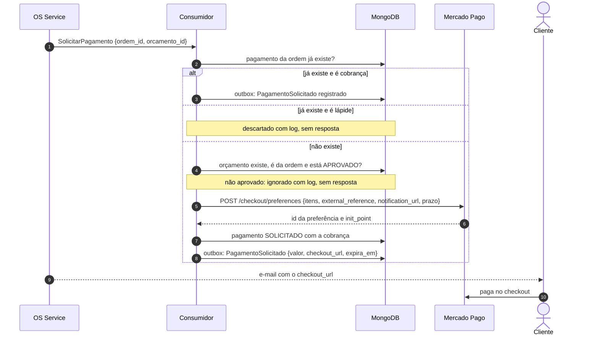

1. O comando é idempotente pela ordem, como o `GerarOrcamento`: repetido, republica o `PagamentoSolicitado`; depois da lápide, é descartado.
2. O orçamento tem de existir e ser da ordem do comando; senão a mensagem vai para a DLQ, e o orquestrador compensa pelo prazo técnico. Orçamento que não está `APROVADO` é descompasso de estado: o consumidor confirma o consumo (*ack*), registra o log `command_ignored` com o código e não responde; a saga segue pelo evento que já recebeu ou pelo prazo.
3. A preferência leva as linhas congeladas do orçamento, a `external_reference` (o id do pagamento), a `notification_url` do webhook e o prazo (`PAGAMENTO_VALIDADE_MINUTOS`). Criar a preferência não é repetido automaticamente: a recusa do provedor é falha permanente (DLQ), e o provedor fora do ar é erro transitório (fila de retry).
4. O pagamento nasce `SOLICITADO` com o `checkout_url`. Dois comandos simultâneos da mesma ordem: o índice único de `ordem_id` deixa um só gravar, e a cobrança criada pelo outro fica órfã no provedor e expira sozinha, porque o link dela nunca é publicado.
5. Com `MP_MODE=simulado`, no lugar do Mercado Pago o checkout é uma página do próprio Billing (`/simulador/checkout/{pagamento_id}`), com um token HMAC no `checkout_url`; o ambiente de demonstração usa esse modo.

### 4.4 Webhook assinado, conciliação e estorno automático

O status do pagamento nunca vem do corpo da notificação: o Billing consulta o Mercado Pago pelo `data.id` da query, o único valor que a `x-signature` cobre.

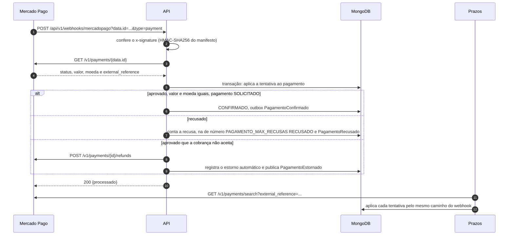

1. **Assinatura.** O manifesto é `id:<data.id em minúsculas>;request-id:<x-request-id>;ts:<ts>;`, e a parte ausente sai do manifesto. A API compara o HMAC-SHA256 com o `v1` do cabeçalho em tempo constante, com o segredo `MP_WEBHOOK_SECRET`. Assinatura ausente ou inválida responde 401 e conta na métrica `pytstop_webhook_assinatura_invalida_total`. Sem o segredo no servidor, a rota responde 503.
2. **Tipo da notificação.** A query opcional `type` prevalece sobre o corpo; ausente ou vazia, usa o `type` do corpo, sem restringir os valores por enum. **O que a API responde 200 sem processar:** notificação sem `data.id` (essa checagem vem antes da assinatura) e, com a assinatura válida, notificação de outro tipo que não `payment`; sem a assinatura, a de outro tipo responde 401. O Mercado Pago só para de reenviar com 2xx. O corpo JSON é obrigatório; sem ele, 422.
3. **Consulta.** `GET /v1/payments/{id}` devolve a tentativa. Referência que o provedor não conhece, ou cuja `external_reference` não é um pagamento nosso, responde 200 com `processado: false`. Provedor fora do ar responde 503 e o Mercado Pago reenvia.
4. **Aplicação.** Cada par (tentativa, status do provedor) entra no histórico `notificacoes` uma vez; repetir a mesma notificação não grava nada. Aprovação de valor e moeda iguais num pagamento `SOLICITADO` confirma. Cada tentativa recusada nova soma em `recusas`, e a de número `PAGAMENTO_MAX_RECUSAS` encerra a cobrança como `RECUSADO`, porque no Checkout Pro o comprador pode tentar de novo depois de uma recusa.
5. **Estorno automático.** Aprovação que a cobrança não aceita (já encerrada, ou de valor ou moeda diferentes) é estornada na hora, fora da transação, com a chave de idempotência `estorno-{pagamento_id}-{tentativa}`. O resultado fica em `estornos_automaticos`. A cobrança encerrada sem pagamento vira `ESTORNADO` e publica `PagamentoEstornado{motivo=pagamento_apos_encerramento}`; a recusa do provedor ao estorno fica marcada em `falha`, sem evento, para o operador resolver.
6. **Conciliação.** Com o Mercado Pago real, o `prazos` busca por `external_reference` cada pagamento `SOLICITADO` e aplica cada tentativa pelo mesmo caminho do webhook, o que cobre a notificação perdida. Com o simulador não há conciliação: o estado do simulador vive na memória da API.

### 4.5 Compensações e lápide

O OS Service decide o plano e a ordem das compensações e manda uma por vez, esperando a resposta ([RFC-004, seção 4.4](https://github.com/fiap-postech-sw-architecture/postech-sw-arch-p4-platform/blob/main/docs/arquitetura/rfc/fase4/rfc-004-microsservicos-saga.md#44-pivot-e-plano-de-compensação)). As duas que chegam ao Billing respondem sempre, inclusive repetidas.

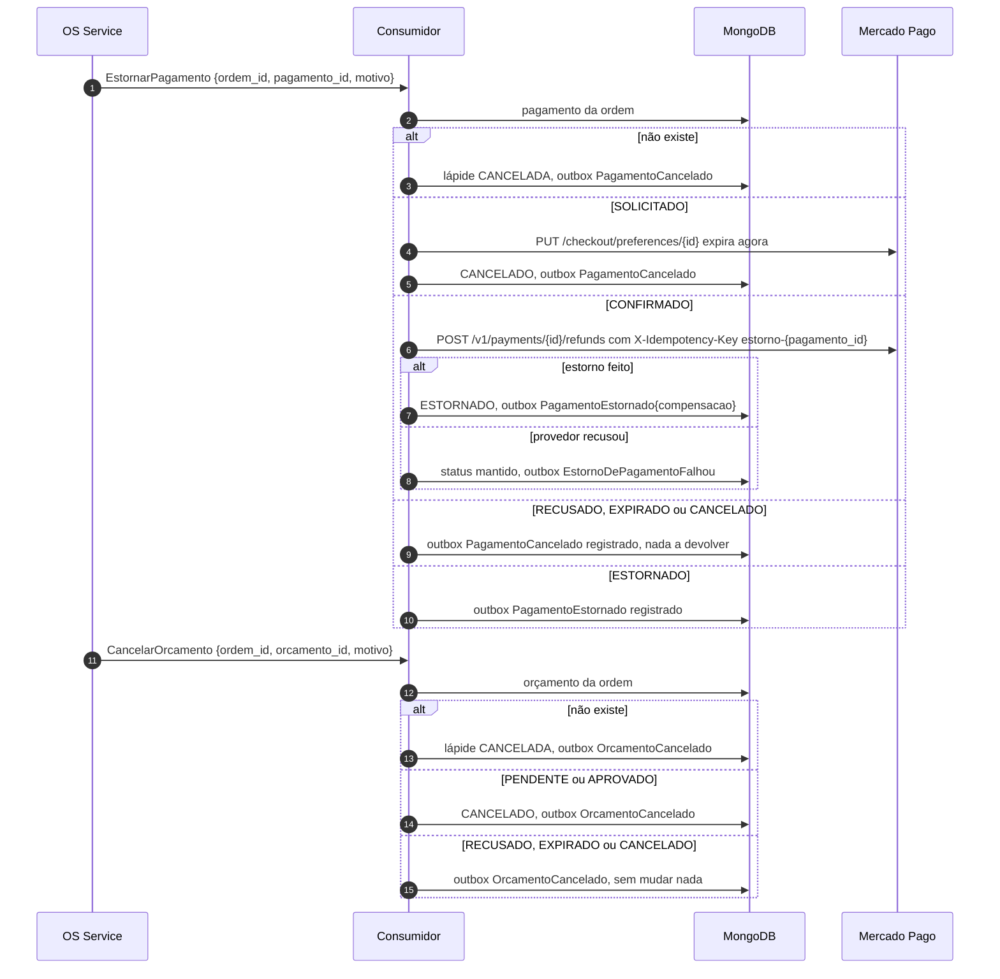

1. **`EstornarPagamento`.** O agregado diz o plano pelo estado. No `SOLICITADO`, fecha o checkout no provedor; se o provedor recusar fechar, a compensação conclui do mesmo jeito, com métrica e o log `checkout_close_refused` (só o código), e quem pagar nele depois cai no estorno automático. No `CONFIRMADO`, confere antes se o pagamento já foi estornado no provedor (pelo painel) e só então estorna; recusa do provedor vira `EstornoDePagamentoFalhou`, e o OS para a saga em falha na compensação, à espera do operador. Estorno ainda em processamento é erro transitório: o comando volta pela fila de retry.
2. **`CancelarOrcamento`.** Acha o orçamento pelo `ordem_id`; o `orcamento_id` do comando, quando vem, tem de ser o desse orçamento, senão o comando é recusado como não encontrado e vai para a DLQ.
3. **Lápide.** A compensação que chega antes do comando original (o passo em voo, [RFC-004, seção 4.5](https://github.com/fiap-postech-sw-architecture/postech-sw-arch-p4-platform/blob/main/docs/arquitetura/rfc/fase4/rfc-004-microsservicos-saga.md#45-contramedidas-de-isolamento)) grava o agregado já cancelado, sem cobrança nem linhas, e responde. O original, quando chegar, acha a lápide pelo índice único de `ordem_id` e é descartado. Se a geração (ou a solicitação) comitar entre a leitura e a escrita da lápide, a compensação repete e cancela o que existe.

### 4.6 Expiração

O processo `prazos` roda em ciclos. Cada ciclo concilia (com o Mercado Pago real), expira os orçamentos vencidos e expira os pagamentos vencidos, cada um na sua transação, que relê o agregado e só muda se o estado esperado ainda vale.

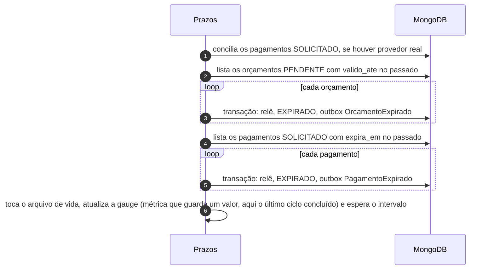

1. A conciliação vem antes da expiração, para um pagamento aprovado dentro do prazo não vencer por falta do webhook.
2. Orçamento decidido ou cancelado depois da listagem, ou pagamento confirmado depois dela, não expira: a escrita que chegou antes vence.
3. O ciclo trata até 100 registros de cada tipo; se uma expiração bate nesse limite, o ciclo seguinte começa sem esperar. A conciliação não conta para isso, para não repetir a consulta ao provedor sem pausa.
4. Um documento com defeito não trava a fila: a falha dele vai para o log e o ciclo segue.

### 4.7 Outbox, relay e consumidor

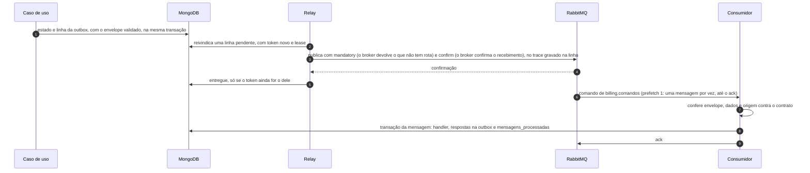

- **Gravação.** O caso de uso registra o evento na unidade de trabalho, que grava a linha da outbox no commit. O envelope fora do contrato é defeito deste serviço e aborta a transação.
- **Relay** ([`relay.py`](../src/compartilhado/infraestrutura/mensageria/relay.py)): reivindica uma linha por vez com um `find_one_and_update` atômico, que grava um token e o lease. Toda marcação posterior exige o token, então um relay atrasado não marca como entregue o que outro retomou. Sem rota, nack ou recusa do broker contam tentativa, com atraso crescente, e a quinta falha vira `dead`; queda do broker devolve a linha sem gastar tentativa. O tamanho do lease, os atrasos e a reconexão estão em [Mensageria](mensageria.md).
- **Consumidor** ([`consumidor.py`](../src/compartilhado/infraestrutura/mensageria/consumidor.py)): o handler roda na transação da mensagem, que o consumidor abre e comita. O mesmo `id` de novo passa pelo caso de uso, idempotente pela chave de negócio, que republica o desfecho sem repetir o efeito. Erro transitório publica a cópia na fila de retry do nível da nova tentativa; erro permanente, a sexta falha ou a cópia recusada vão para a DLQ. O redrive da DLQ é `make redrive` do `platform`, depois de corrigida a causa.
- **Polling.** O relay do Billing consulta a outbox em intervalos, como a [RFC-004, seção 5.4](https://github.com/fiap-postech-sw-architecture/postech-sw-arch-p4-platform/blob/main/docs/arquitetura/rfc/fase4/rfc-004-microsservicos-saga.md#54-garantias-de-entrega) descreve para o MongoDB.

## 5. Mensageria

A topologia, o envelope, o catálogo de comandos e eventos e as garantias de entrega são da RFC-004, seções [4](https://github.com/fiap-postech-sw-architecture/postech-sw-arch-p4-platform/blob/main/docs/arquitetura/rfc/fase4/rfc-004-microsservicos-saga.md#4-saga-de-atendimento) e [5](https://github.com/fiap-postech-sw-architecture/postech-sw-arch-p4-platform/blob/main/docs/arquitetura/rfc/fase4/rfc-004-microsservicos-saga.md#5-mensageria), e do [ADR-036](https://github.com/fiap-postech-sw-architecture/postech-sw-arch-p4-platform/blob/main/docs/arquitetura/adr/fase4/036-mensageria-rabbitmq.md). Os contratos são a cópia em [`contratos/`](../contratos), presa ao commit de [`contratos/ORIGEM`](../contratos/ORIGEM).

As duas tabelas abaixo são tudo o que este serviço consome e publica. Os testes as comparam com o catálogo do código (`COMANDOS` e os schemas de `contratos/`, o `asyncapi.yaml` e a fila de `src/consumidor.py`): mensagem nova sem linha aqui, ou com a routing key, a fila ou o produtor trocados, reprova o `make test`. Três colunas não têm teste: "Etapa esperada", porque a tabela dela é do OS Service, e "Resposta" (comandos) e "Quando sai" (eventos), porque o código não guarda esse mapeamento em campo estruturado (o `asyncapi.yaml` o diz só em texto); da "Resposta" se confere apenas que o evento citado existe.

### Comandos consumidos

Quatro comandos, da fila `billing.comandos` (exchange `pytstop.comandos`, ligação `comando.billing.#`), publicados pelo usuário `os`. A fila de retry de cada nível (`billing.comandos.retry.1s` a `.300s`) e a DLQ (`billing.comandos.dlq`) são da mesma topologia.

| Comando | Routing key | Publica | Consome | Fila | Resposta |
|---|---|---|---|---|---|
| `GerarOrcamento` | `comando.billing.gerar_orcamento` | `os` | `billing` | `billing.comandos` | `OrcamentoGerado` ou `GeracaoDeOrcamentoFalhou` |
| `CancelarOrcamento` | `comando.billing.cancelar_orcamento` | `os` | `billing` | `billing.comandos` | `OrcamentoCancelado` |
| `SolicitarPagamento` | `comando.billing.solicitar_pagamento` | `os` | `billing` | `billing.comandos` | `PagamentoSolicitado` (sem resposta se o orçamento não está aprovado) |
| `EstornarPagamento` | `comando.billing.estornar_pagamento` | `os` | `billing` | `billing.comandos` | `PagamentoCancelado`, `PagamentoEstornado` ou `EstornoDePagamentoFalhou` |

### Eventos publicados

Treze eventos, no exchange `pytstop.eventos`, com o usuário `billing`, todos consumidos pelo OS Service na fila `os.eventos`. A coluna "Etapa esperada" é a etapa da saga em que o OS espera o evento (`ETAPA_ESPERADA`, em `aplicacao/saga/tabela_da_saga.py` do OS Service): fora dela, ele o classifica como ignorado, volta pela fila de retry ou manda para a DLQ. Os eventos de decisão, expiração e pagamento não respondem a comando: o `causation_id` deles é o comando que abriu o orçamento ou o pagamento.

| Evento | Routing key | Publica | Consome | Etapa esperada | Quando sai |
|---|---|---|---|---|---|
| `OrcamentoGerado` | `evento.billing.orcamento_gerado` | `billing` | `os` | `aguardando_orcamento` | resposta ao `GerarOrcamento`, também quando repetido |
| `GeracaoDeOrcamentoFalhou` | `evento.billing.geracao_de_orcamento_falhou` | `billing` | `os` | `aguardando_orcamento` | resposta ao `GerarOrcamento` que não pôde ser cotado |
| `OrcamentoAprovado` | `evento.billing.orcamento_aprovado` | `billing` | `os` | `aguardando_decisao` | o cliente ou o atendente aprovou |
| `OrcamentoRecusado` | `evento.billing.orcamento_recusado` | `billing` | `os` | `aguardando_decisao` | o cliente ou o atendente recusou |
| `OrcamentoExpirado` | `evento.billing.orcamento_expirado` | `billing` | `os` | `aguardando_decisao` | o `prazos` expirou o orçamento pendente |
| `OrcamentoCancelado` | `evento.billing.orcamento_cancelado` | `billing` | `os` | `compensando` | resposta ao `CancelarOrcamento` |
| `PagamentoSolicitado` | `evento.billing.pagamento_solicitado` | `billing` | `os` | `aguardando_pagamento` | resposta ao `SolicitarPagamento`, com o `checkout_url` |
| `PagamentoConfirmado` | `evento.billing.pagamento_confirmado` | `billing` | `os` | `aguardando_pagamento` | o provedor aprovou a cobrança |
| `PagamentoRecusado` | `evento.billing.pagamento_recusado` | `billing` | `os` | `aguardando_pagamento` | a recusa de número `PAGAMENTO_MAX_RECUSAS` fechou a cobrança |
| `PagamentoExpirado` | `evento.billing.pagamento_expirado` | `billing` | `os` | `aguardando_pagamento` | o `prazos` expirou a cobrança solicitada |
| `PagamentoCancelado` | `evento.billing.pagamento_cancelado` | `billing` | `os` | `compensando` | resposta ao `EstornarPagamento` sem dinheiro a devolver |
| `PagamentoEstornado` | `evento.billing.pagamento_estornado` | `billing` | `os` | `compensando` | resposta ao `EstornarPagamento` de pagamento confirmado; o estorno automático (`pagamento_apos_encerramento`) chega em qualquer etapa e só muda o resumo do pagamento no OS |
| `EstornoDePagamentoFalhou` | `evento.billing.estorno_de_pagamento_falhou` | `billing` | `os` | `compensando` | o provedor recusou o estorno da compensação |

### Contratos e garantias

- **Contratos.** `contratos/` é cópia do `platform` no commit de `contratos/ORIGEM`: um JSON Schema por mensagem, os exemplos, o `asyncapi.yaml` e a topologia do broker. O leitor é tolerante a campo novo e recusa `versao` desconhecida; o erro de validação diz o caminho e a regra, nunca o valor.
- **Garantias.** Entrega pelo menos uma vez, com o consumidor idempotente pelo `_id` de `mensagens_processadas` e pela chave de negócio dos casos de uso; outbox na transação do efeito; retry por atraso com uma fila por nível (o TTL é da fila, porque a mensagem só expira na cabeça dela) e DLQ com alerta. Contadores do pagamento são pelo menos uma vez no consumidor (a repetição é rara).
- **Ordem.** A ordem de consumo não é garantida de qualquer forma; quem decide é a etapa da saga ([ADR-036](https://github.com/fiap-postech-sw-architecture/postech-sw-arch-p4-platform/blob/main/docs/arquitetura/adr/fase4/036-mensageria-rabbitmq.md)). O relay publica uma linha por vez, em ordem de `_id`, e uma linha em atraso não segura as seguintes da mesma OS.

## 6. Segurança e LGPD

A LGPD (Lei Geral de Proteção de Dados) trata dado de pessoa natural; o que ela pede deste serviço está no parágrafo "LGPD", mais abaixo.

**Autenticação e autorização** ([ADR-039](https://github.com/fiap-postech-sw-architecture/postech-sw-arch-p4-platform/blob/main/docs/arquitetura/adr/fase4/039-autenticacao-entre-servicos.md)): o Billing não emite token. Valida o JWT (RS256) que o OS Service emite, com a chave pública do JWKS (JSON Web Key Set, o conjunto de chaves públicas que o OS publica), conferindo assinatura, emissor, audiência, expiração, `sub` (UUID), `type=access` e `papel`. Toda falha de credencial responde o mesmo 401 `NAO_AUTENTICADO`, com uma mensagem única; papel válido sem permissão, 403 `ACESSO_NEGADO`; JWKS fora do ar e sem cópia, 503 com `Retry-After`. O `admin` passa em toda rota interna.

| Rotas | Quem acessa |
|---|---|
| `GET /api/v1/saude`, `/saude/pronto` | qualquer um, sem token |
| `GET /api/v1/precos/servicos`, `/pecas` e por código | `atendente`, `mecanico`, `admin` |
| `POST`, `PUT` e `DELETE` em `/api/v1/precos/servicos` e `/pecas` | `admin` |
| `POST /api/v1/precos/validacao` | `mecanico`, `admin` (a Execução repassa o token do mecânico) |
| `GET /api/v1/orcamentos`, `GET` e `POST .../decisao` em `/api/v1/orcamentos/{id}`, `GET /api/v1/pagamentos/{id}` | `atendente`, `admin` |
| `GET` e `POST .../decisao` em `/api/v1/publico/orcamentos/{token}` | quem tem o link (token HMAC do orçamento) |
| `POST /api/v1/webhooks/mercadopago` | o Mercado Pago, pela `x-signature` |
| `GET /simulador/checkout/{id}` e `POST /api/v1/simulador/pagamentos/{id}/aprovar` e `/recusar` | quem tem o token do `checkout_url`; só com `MP_MODE=simulado` |

**O que cada rota devolve, e a quem.** O Billing não guarda nome, documento, contato nem endereço de cliente, então nenhuma resposta tem campo desses dados. O texto livre de recusa do provedor é substituído por uma mensagem fixa antes de sair na API ou nos eventos. O que cada rota traz de identificador ou de credencial:

| Rota | O que devolve | Identificador ou credencial na resposta |
|---|---|---|
| Sondas | `status` e, na liveness (a sonda cuja falha reinicia o contêiner), o `modo` do pagamento | nenhum |
| Preços, leitura e escrita | o preço, a moeda e o `ativo` | nenhum; a escrita deixa um log de auditoria com o `sub` do admin |
| Validação de itens | os códigos que o chamador mandou e não existem ou estão inativos | nenhum |
| Orçamento, consulta e decisão do atendente | o orçamento inteiro: `ordem_id`, linhas, total, prazo, decisão e `motivo_cancelamento` | `decisao.decidido_por` é o `sub` do atendente (UUID, não o nome) |
| Orçamento, link público | `id`, status, linhas, total, moeda, `valido_ate` e `decisao` | nenhum: sem `ordem_id`, `criado_em` e `motivo_cancelamento`, e `decidido_por` sempre nulo |
| Pagamento, consulta interna | o pagamento inteiro, com as notificações e os estornos automáticos | `ordem_id`; o `checkout_url`, que é credencial (no simulador leva o token que aprova o pagamento; no provedor real, o link do checkout); a falha de estorno usa mensagem fixa |
| Webhook | `{"processado": true ou false}` | nenhum |
| Simulador | a página HTML (id, valor, status e o token nos botões); o `POST` devolve o pagamento inteiro, como a consulta interna | `ordem_id` e o `checkout_url` com o token, para quem já tem o token |

**Erros e status.** O erro vem no envelope `{"erro": {"codigo", "mensagem", "id_requisicao"}}`. O 422 de validação de schema é a exceção: `{"detail": [{"type", "loc", "msg"}], "id_requisicao"}`, sem ecoar o valor recebido. Alguns casos que a leitura do decorator não mostra:

- **Código ou SKU de preço fora do formato** (`srv-x`, ou 60 caracteres) em `GET`, `PUT` e `DELETE` por código dá 404, não 422: o parâmetro de caminho não tem formato, e a mensagem do 404 cita o código pedido. O formato vale no corpo do `POST` (422).
- **Invariante de domínio** que o schema não pega (um nome só com espaços, por exemplo) dá 422 `VALOR_INVALIDO`, com a mensagem do domínio sem CPF, CNPJ, e-mail e telefone e cortada em 200 caracteres.
- **Corpo sem `Content-Type: application/json`** dá 422 (`model_attributes_type`), inclusive no webhook, que exige corpo.
- **Link público.** Token adulterado, expirado, de orçamento inexistente ou já decidido: 404 `LINK_DECISAO_INVALIDO`, igual para todos. Corpo inválido no `POST` dá 422 antes de olhar o token. Um `/` a mais no fim do caminho não casa a rota e dá o 404 genérico `ENTIDADE_NAO_ENCONTRADA`, porque a API não redireciona.
- **Checkout do simulador.** Token ausente, inválido, expirado ou de outro pagamento: 404 `CHECKOUT_NAO_ENCONTRADO`; o token do link de decisão não abre o checkout (domínios de assinatura diferentes). Pagamento que já não está `SOLICITADO`: 409.
- **Banco fora.** Falhas de conexão e timeout do MongoDB respondem 503 `DEPENDENCIA_INDISPONIVEL`, com `Dependencia externa indisponivel; tente novamente`, sem detalhe do driver. Na API, o cliente e cada transação têm limite de 2 s, sem incluir a espera do provedor; os workers mantêm operação/transação de 10 s e seleção de servidor de 5 s. Documento inválido, erro de programação e `OperationFailure` comum continuam 500. A readiness responde 503 em cerca de 2 s e tira o pod do Service, e a liveness segue 200.
- **Ordem das checagens** nas rotas internas: token (401), papel (403), corpo e parâmetros (422) e só então o banco (404, 409, 410).

**Segredos e dados sensíveis:**

- O token do link de decisão e o do checkout são credenciais: saem mascarados do log, do access log e do atributo de URL dos spans. O `link_decisao` e o `checkout_url` nunca vão para log nem para atributo de span. O id da preferência (que compõe o link do checkout), o id do pagamento e a query da busca também não: o span de cliente do httpx leva o template da rota (`/v1/payments/{id}`), não a URL.
- O `ORCAMENTO_LINK_SECRET` é obrigatório e forte fora de desenvolvimento (o valor de demonstração é recusado no boot); o `MP_ACCESS_TOKEN` e o `MP_WEBHOOK_SECRET` vêm de Secret, e o valor de cada um não está em nenhum arquivo do repositório. Como obtê-los no cluster está em [Implantação](implantacao.md).
- O texto livre da recusa do provedor (`message` e `description`) não entra em nenhum log. A exceção usa `Provedor de pagamento recusou a operacao`: novos `estornos_automaticos[].falha`, o `motivo` do `EstornoDePagamentoFalhou` e o corpo do 409 do webhook levam esse texto. A consulta apresenta falhas antigas com a mesma mensagem fixa, sem alterar o documento salvo, e mantém `falha: null` para sucesso.
- Logs e erros passam por um mascaramento de CPF, CNPJ, e-mail, telefone e chaves sensíveis, inclusive o traceback; os spans não levam o texto das exceções nem o caminho cru da URL.

**LGPD.** O Billing não recebe nome, documento nem contato (o OS Service, dono do cadastro, manda e-mail e elimina os dados do titular), e por isso **não tem fluxo de anonimização**: o `AnonimizarVeiculo` da eliminação é um comando da Execução, e nenhum comando do Billing leva dado do titular. O que sobra são identificadores (`ordem_id`, o `sub` do atendente) e os textos do provedor acima.

**Retenção.** Linha entregue da outbox por 7 dias, linha `dead` por 30 e `mensagens_processadas` por 30, por índice TTL (seção 3.5). Orçamentos, pagamentos e preços não expiram por tempo.

**Infraestrutura** ([Implantação](implantacao.md)): pods sem root, raiz somente leitura, sem token de ServiceAccount e com seccomp `RuntimeDefault`; NetworkPolicy que nega toda entrada e libera só o necessário; no MongoDB, o usuário `billing` serve aos processos e ao Job, o `exporter` (só `clusterMonitor`) serve ao exporter, e o `root` só ao primeiro boot do volume e ao initContainer `replica-set` do Job; nenhum segredo nos manifestos.

## 7. Observabilidade

Métricas, traces e logs seguem o [ADR-043](https://github.com/fiap-postech-sw-architecture/postech-sw-arch-p4-platform/blob/main/docs/arquitetura/adr/fase4/043-observabilidade-distribuida.md). O catálogo das métricas dos três serviços, os painéis e os alertas estão no [README de observabilidade do `platform`](https://github.com/fiap-postech-sw-architecture/postech-sw-arch-p4-platform/blob/main/observabilidade/README.md#catálogo-de-métricas).

- **Métricas.** Cada processo serve o `/metrics` (a API junto da porta HTTP, fora da borda; os outros três numa porta própria). As séries de rótulo fechado nascem com zero no boot. Os contadores do pagamento contam depois do commit; as gauges da outbox saem de um coletor com prazo próprio e somem, em vez de zerar, quando o banco não responde.
- **Traces.** O contexto W3C atravessa a outbox e os cabeçalhos AMQP: a publicação do relay é filha de quem gravou, o consumidor abre o span de consumo como filho da publicação, e o evento que a saga publica depois de uma decisão, de um webhook ou de um prazo aponta para o contexto de quem retomou o passo por span link.
- **Logs.** JSON com `correlation_id` (a ordem), `trace_id` e `span_id`, sem dado pessoal nem texto livre do provedor. O `event` vem em inglês.

A tabela das séries, o que não é exportado e por quê, e como ver o Jaeger, o Grafana e o Prometheus estão em [Observabilidade](observabilidade.md).

## 8. Decisões

| Decisão | Onde está |
|---|---|
| Três serviços; o Billing é dono de preço, orçamento e pagamento | [ADR-034](https://github.com/fiap-postech-sw-architecture/postech-sw-arch-p4-platform/blob/main/docs/arquitetura/adr/fase4/034-decomposicao-em-microsservicos.md) |
| Participante da saga orquestrada, que compensa por comando | [ADR-035](https://github.com/fiap-postech-sw-architecture/postech-sw-arch-p4-platform/blob/main/docs/arquitetura/adr/fase4/035-saga-orquestrada.md) |
| RabbitMQ com outbox transacional, consumidor idempotente, retry por atraso e DLQ | [ADR-036](https://github.com/fiap-postech-sw-architecture/postech-sw-arch-p4-platform/blob/main/docs/arquitetura/adr/fase4/036-mensageria-rabbitmq.md) |
| MongoDB próprio, em replica set, com credencial só nos pods do serviço | [ADR-037](https://github.com/fiap-postech-sw-architecture/postech-sw-arch-p4-platform/blob/main/docs/arquitetura/adr/fase4/037-banco-por-servico.md) |
| Borda no Kong, com o `/metrics` fora dela; o Billing só recebe a chamada síncrona da Execução | [ADR-038](https://github.com/fiap-postech-sw-architecture/postech-sw-arch-p4-platform/blob/main/docs/arquitetura/adr/fase4/038-borda-e-comunicacao-sincrona.md) |
| JWT emitido pelo OS e validado localmente pelo JWKS, papel por rota | [ADR-039](https://github.com/fiap-postech-sw-architecture/postech-sw-arch-p4-platform/blob/main/docs/arquitetura/adr/fase4/039-autenticacao-entre-servicos.md) |
| Checkout Pro do Mercado Pago, status sempre da consulta ao provedor, simulador para demonstração | [ADR-040](https://github.com/fiap-postech-sw-architecture/postech-sw-arch-p4-platform/blob/main/docs/arquitetura/adr/fase4/040-integracao-mercado-pago.md) |
| Cobertura de 95% no total e 90% no código novo, mutação nos módulos críticos | [ADR-041](https://github.com/fiap-postech-sw-architecture/postech-sw-arch-p4-platform/blob/main/docs/arquitetura/adr/fase4/041-estrategia-de-testes-e-qualidade.md), [README, Cobertura](../README.md#cobertura) |
| CI por serviço e deploy no Kubernetes, com migração que expande e contrai | [ADR-042](https://github.com/fiap-postech-sw-architecture/postech-sw-arch-p4-platform/blob/main/docs/arquitetura/adr/fase4/042-cicd-e-deploy-kubernetes.md) |
| Traces, métricas e logs correlacionados pela ordem | [ADR-043](https://github.com/fiap-postech-sw-architecture/postech-sw-arch-p4-platform/blob/main/docs/arquitetura/adr/fase4/043-observabilidade-distribuida.md) |

Decisões deste serviço que não estão nos ADR:

- **Transação do MongoDB com repetição do trabalho.** A unidade de trabalho é `executar(trabalho)` sobre `ClientSession.with_transaction`, com leitura `snapshot` e escrita `majority`, sem campo de versão no agregado: o conflito de escrita (`WriteConflict`) repete o trabalho relendo o agregado. Por isso a chamada ao Mercado Pago fica fora do `executar` ([`unit_of_work.py`](../src/compartilhado/infraestrutura/unit_of_work.py)).
- **Atualização por `$set`, não por substituição.** O `aberto_por` é gravado com `$setOnInsert` na criação durante um comando e precisa sobreviver às gravações seguintes, então os repositórios de orçamento e de pagamento usam `update_one` com `$set` sem o `_id`.
- **Estorno automático com chave por tentativa.** A chave de idempotência é `estorno-{pagamento_id}-{tentativa}`, e a da compensação é `estorno-{pagamento_id}`: uma segunda tentativa paga do mesmo checkout não pode reaproveitar a resposta do primeiro estorno ([`use_cases.py`](../src/pagamento/aplicacao/use_cases.py)).
- **Cópia própria do JWKS.** Fresca por 10 minutos, com a última cópia boa valendo até 1 hora quando o OS está fora, no lugar do cache do `PyJWKClient` que o ADR-039 descreve ([`jwks.py`](../src/compartilhado/infraestrutura/jwks.py)).
- **Lápide por `ordem_id`.** A compensação que chega antes do comando original grava o agregado já cancelado, em vez de falhar ([`use_cases.py` do orçamento](../src/orcamento/aplicacao/use_cases.py) e [do pagamento](../src/pagamento/aplicacao/use_cases.py)).
- **OpenAPI com o simulador ligado.** O `docs/api/openapi.json` é o do `MP_MODE=simulado`, que tem as três rotas do simulador; com o Mercado Pago real elas não existem ([`gerar_docs_api.py`](../scripts/gerar_docs_api.py)).
